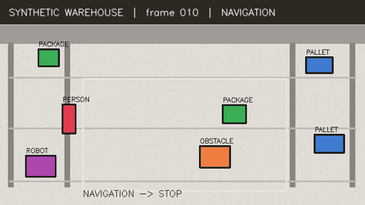
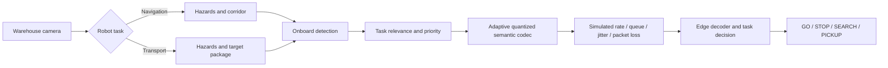
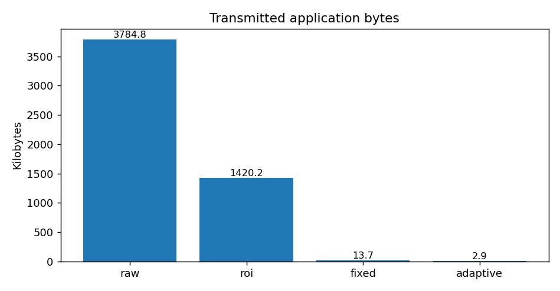
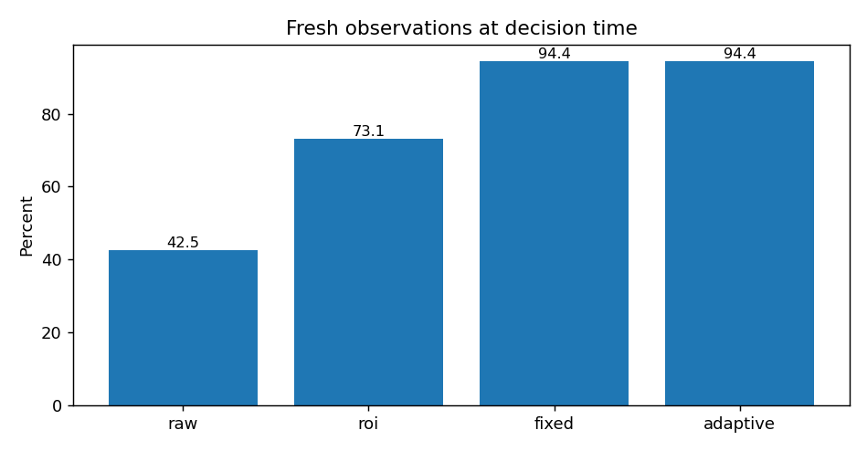

# Adaptive Semantic Robotic Communication

### Task-aware edge perception under bandwidth and reliability constraints

[](https://github.com/ChanYanxin/adaptive-semantic-robotic-communication/actions/workflows/tests.yml)

**Engineering prototype | Python · OpenCV · MessagePack · Network modeling · TCP · optional YOLO / ROS 2**

A reproducible warehouse-robot perception and communication experiment. A robot switches between **navigation** and **package transport**. Instead of always transmitting full camera frames to the edge, it can transmit a task-specific semantic message: object categories, quantized bounding boxes and confidence. A bandwidth-aware policy favors safety-relevant objects, under an explicit byte budget.

> **Evidence boundary:** The default demonstration uses deterministic **synthetic warehouse images** and a **hand-crafted color detector**, *not* a trained CV model. Link delay/loss is **simulated**, not measured over Wi-Fi or 6G. The optional YOLO, ROS 2 and real loopback TCP integration do not establish deployment on a physical robot. Figures are engineering toy-benchmark outcomes, not research/generalization/safety claims.



_Synthetic warehouse animation. Real robotic perception and wireless link performance are not demonstrated._

## Research question

**How much communication can be saved by transmitting only task-relevant semantic information while maintaining adequate hazard perception and timely task decisions under variable link conditions?**

The code was developed as a portfolio-scale prototype aligned with the research themes *Task-Centric Perception, Semantic Communication, Robotic Vision, Edge Intelligence* and *6G-enabled networked intelligence* in the RWTH Aachen INDA Priority HiWi Program, *Task-Centric Robotic Perception and Recognition in Mobility and Production*. No institutional affiliation or endorsement is implied.

## Architecture



Note that `raw` and `roi` baselines detect **on edge after image transmission** whereas `fixed` and `adaptive` run the detector **onboard before sending semantic objects**. The benchmark accounts for this compute placement and uses a single host for measured CPU cost.

## Four comparable methods

| Method | Payload | Where detection runs | Why compare? |
| --- | --- | --- | --- |
| `raw` | Full JPEG frame | Edge | conventional full-frame offloading |
| `roi` | Task ROI crop + JPEG | Edge | image-level reduction |
| `fixed` | All detections + boxes + confidence, MessagePack | Onboard | conventional structured semantics |
| `adaptive` | Risk/task-selected, quantized detections within link-dependent budget | Onboard | our transparent task-aware approach |

### Baseline results (160 synthetic frames)



| Metric | Raw | ROI | Fixed | Adaptive |
| --- | ---: | ---: | ---: | ---: |
| Application bytes transmitted, fixed 4Mbps link | 3,784,837 | 1,420,227 | 13,687 | 2,944 |
| Toy decision accuracy, fixed link | 99.38% | 99.38% | 99.38% | 99.38% |
| Fresh observations, fixed link | 98.12% | 98.12% | 98.12% | 98.12% |
| Fresh observations, degraded 4Mbps link | 69.37% | 95.63% | 95.63% | 95.63% |
| Fresh observations, severe 2Mbps link | 42.50% | 73.12% | 94.37% | 94.37% |
| Hazard observation recall, severe 2Mbps link | 44.19% | 67.44% | 93.80% | 93.80% |
| Task-relevant object recall after channel, severe link | 64.65% | 88.38% | 92.42% | 87.37% |

Adaptive uses **99.92% fewer application bytes than full JPEG** and **78.49% fewer than fixed structured semantics** on this one generated scene. These are *not real-life transmission improvements*. The 4Mbps degraded-link result illustrates a simple backlog effect on full JPEG traffic, not a universal result.

The severe-link case uses bandwidth phases down to 0.5Mbps and increased losses. Its *adaptive* encoder drops some lower-priority package records when the 28-byte budget is binding, explaining lower object recall than the fixed semantic baseline (87.37% versus 92.42%) while maintaining equal toy hazard observation recall. This is a **measured trade-off inside a synthetic simulator**, not evidence of real-world safety.



The synthetic experiment has a conservative STOP fallback that can preserve decision recall even when a hazard is not observed. We therefore **separately measure real hazard observation recall** (e.g., raw 64.34% versus adaptive 95.35% under the degraded simulated link). Full settings, random seeds, CPU limitations and metrics: [Experiments](docs/EXPERIMENTS.md) and [Design constraints](docs/DESIGN.md).

## Quick start

Python 3.10+; no special robotics hardware or GPU required.

```bash
python -m venv .venv
source .venv/bin/activate                   # Windows: .venv\\Scripts\\activate
python -m pip install -e ".[test,plots]"
pytest
semantic-robot benchmark --frames 160 --out results/default --plots
semantic-robot benchmark --frames 160 --out results/degraded --variable-link --plots
semantic-robot benchmark --frames 160 --bandwidth 2 --loss 0.02 --variable-link --out results/severe --plots
python examples/ablation.py
```

With missing development dependencies, install `numpy`, `opencv-python-headless`, `msgpack`, `matplotlib` and `pytest` (see `pyproject.toml`). The benchmark is reproducible with fixed random seeds; machine-dependent CPU timings will vary. The output folder contains `summary.json`, `frame_metrics.csv`, and optional plots.

### Real local TCP demonstration

Two shells on the same machine:

```bash
python -m semantic_robot.tcp_demo server
# second terminal:
python -m semantic_robot.tcp_demo client --method adaptive
```

This sends a length-framed MessagePack request through an actual TCP socket and obtains the edge decision. It demonstrates the transport interface **on loopback**, not wireless throughput performance.

### Optional YOLO / ROS 2

```bash
python -m pip install -e ".[yolo]"
# from Python: from semantic_robot.vision import YoloDetector
# detector = YoloDetector(weights="yolov8n.pt")  # requires download of model weights
```

Pretrained COCO categories are only roughly mapped to `person`, `package` and `obstacle`; custom warehouse models and validated datasets are needed for realistic evaluation. ROS 2 adapter in `src/semantic_robot/ros2_bridge.py` publishes an illustrative `std_msgs/String` state if ROS 2 is separately installed. Neither integration is used by default benchmark or CI.

### Encoder ablation

The same detected objects, without any network simulation, give average encoded payloads of **85.54 B** (all detections, full precision), **72.33 B** (all detections, quantized), **23.34 B** (task selection only), and **18.40 B** (task selection plus quantization). See `examples/ablation.py`; the values are dataset-specific.

## Directory map

```text
src/semantic_robot/
  warehouse.py      deterministic synthetic scene / truth
  vision.py         color segmentation + optional YOLO adapter
  decision.py       navigation / transport task semantics
  codec.py          four codecs / priority / rate-dependent budget
  channel.py        seeded FIFO network simulator
  benchmark.py      paired runs, frame metrics, summary JSON
  plots.py          figures
  tcp_demo.py       real framed TCP request / response
  ros2_bridge.py    optional state publishing bridge
  cli.py            command-line experiment entrypoint
examples/ablation.py   isolate relevance filtering and quantization
results/              generated outputs (gitignored)
tests/                deterministic unit + integration tests
docs/                 design, experiments, interview guidance, preview
.github/workflows/    CI for Python 3.10 and 3.12
```

## Rigor and limitations

- **No real learned semantic encoder, real 6G stack, event camera, Gazebo physics, real robot navigation, trained box recognition, or measured Wi-Fi latency.**
- Model makes hard-coded corridor assumptions and a deliberately simple task decision; accuracy is agreement with a toy ground-truth rule, not a robot mission success rate or mAP.
- Application bytes exclude protocol and PHY overhead. The simulation uses per-message losses (no retransmission), and simple bandwidth-limited queuing.
- The seemingly strong traffic savings partly rely on performing image recognition onboard. Real embedded onboard CPU and energy must be tested before claiming an overall system efficiency improvement.
- Safe STOP when data is unavailable should not be confused with hazard perception. The benchmark logs both independently.
- Additional research should compare learned task-aware features and rate-distortion methods, test real objects and measured on-device inference and link behavior, and run a mobile robot in Gazebo/ROS 2.

See [engineering design](docs/DESIGN.md), [experiment protocol](docs/EXPERIMENTS.md), and [technical interview discussion](docs/INTERVIEW_GUIDE.md).

## License

MIT. Built as a transparent educational/research prototype. Do not use for autonomous safety-critical actuation.
